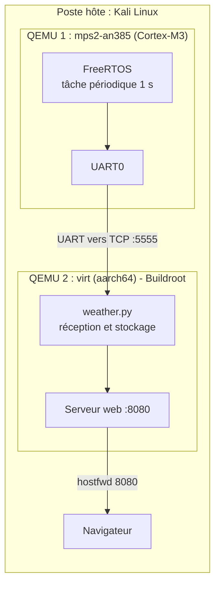
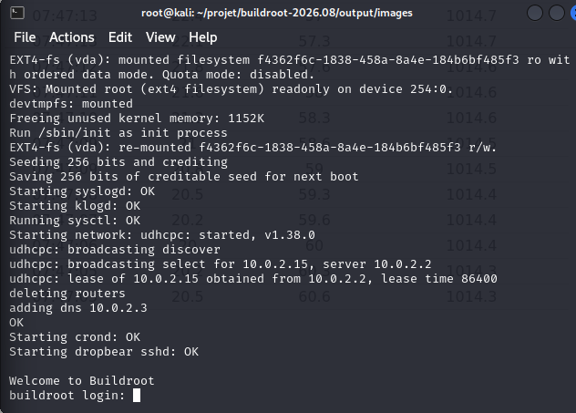
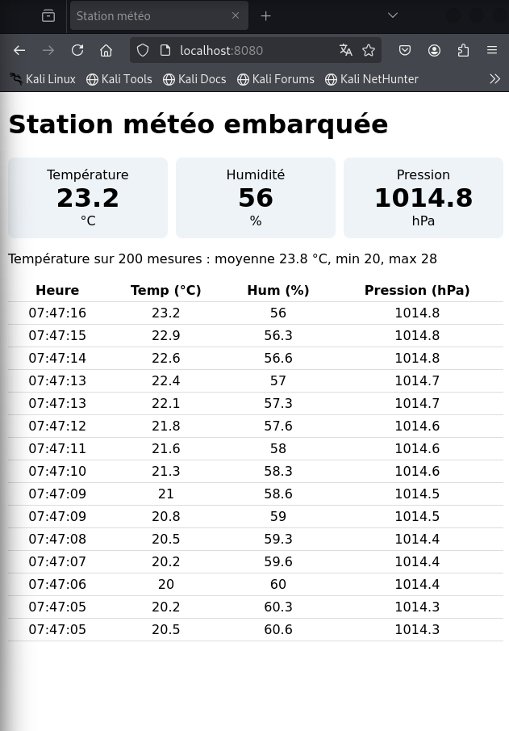

# Station météo embarquée : Linux (Buildroot) + RTOS (FreeRTOS) sous QEMU

Système embarqué hybride entièrement émulé avec QEMU : un **RTOS** produit des mesures
à intervalle régulier, un **Linux embarqué** construit avec Buildroot les reçoit, les
stocke et les affiche sur une **page web**. Aucun matériel n'est nécessaire.


## Sommaire

1. [Présentation](#présentation)
2. [Architecture](#architecture)
3. [Concepts clés](#concepts-clés)
4. [Contenu du dépôt](#contenu-du-dépôt)
5. [Prérequis](#prérequis)
6. [Installation pas à pas](#installation-pas-à-pas)
7. [Lancer le système](#lancer-le-système)
8. [Résultats](#résultats)
9. [Problèmes rencontrés](#problèmes-rencontrés)
10. [Limites](#limites)
11. [Pistes d'évolution](#pistes-dévolution)
12. [Licence](#licence)

## Présentation

Ce projet répond au sujet « développer un système Linux embarqué sous QEMU (RTOS + App) ».
Il met en œuvre une architecture courante dans l'industrie, où le **temps réel** et le
**haut niveau** sont séparés :

| Couche | Rôle | Technologie |
|---|---|---|
| Acquisition temps réel | Produit une mesure toutes les secondes, avec une période exacte | FreeRTOS sur Cortex-M3 |
| Liaison | Transporte les mesures entre les deux systèmes | Série (UART) redirigée vers TCP |
| Application | Reçoit, stocke et affiche les mesures | Python 3 sur Linux embarqué |
| Système | Linux minimal construit sur mesure | Buildroot, aarch64 |

Les capteurs (température, humidité, pression) sont **simulés** par le RTOS, ce qui permet
de tester toute la chaîne sans matériel.

## Architecture



Deux machines QEMU sont nécessaires, car le RTOS (microcontrôleur Cortex-M3) et Linux
(processeur aarch64) ont des architectures différentes. Détails, séquence d'échanges et
réseau émulé : [`docs/architecture.md`](docs/architecture.md).

## Concepts clés

**Linux embarqué.** Version allégée de Linux, construite pour un matériel précis : noyau
configuré, système de fichiers racine minimal (BusyBox), et l'application. Ici construit
avec **Buildroot**.

**QEMU.** Émulateur de machines. Il simule processeur, mémoire et périphériques sur
l'ordinateur de développement.

**RTOS.** Système d'exploitation temps réel, conçu pour exécuter des tâches dans des délais
prévisibles. Linux standard optimise le débit moyen, pas la latence garantie.

**Architecture hybride.** Le RTOS gère ce qui exige un timing précis (acquisition), Linux
gère le reste (réseau, stockage, interface).

## Contenu du dépôt

```
.
├── README.md
├── LICENSE
├── app/
│   └── weather.py              Application Linux : acquisition, stockage, serveur web
├── rtos/
│   ├── app_main.c              Tâche FreeRTOS (remplace celui de la démo MPU)
│   └── README.md               Compilation et lancement du RTOS
├── scripts/
│   ├── run-rtos.sh             Lance le RTOS dans QEMU (série vers TCP 5555)
│   └── make-start-meteo.sh     Crée le script de lancement du Linux avec hostfwd 8080
├── configs/
│   └── README.md               Configuration Buildroot (defconfig)
└── docs/
    ├── architecture.md         Schémas détaillés, séquence, réseau, format de données
    ├── troubleshooting.md      Problèmes rencontrés et solutions
    └── images/                 Captures d'écran
```

## Prérequis

| Élément | Détail |
|---|---|
| Système hôte | Linux (testé sous Kali Linux) |
| Espace disque | 30 à 50 Go pour la compilation de Buildroot |
| Mémoire | Au moins 4 Go de RAM conseillés, plus du swap si besoin |
| Outils | `build-essential git wget cpio unzip rsync bc libncurses-dev file python3` |
| Émulation | `qemu-system-arm` (inclut aarch64) |
| RTOS | `gcc-arm-none-eabi`, `make` |

```bash
sudo apt update
sudo apt install -y build-essential git wget cpio unzip rsync bc libncurses-dev \
    file python3 qemu-system-arm gcc-arm-none-eabi make netcat-openbsd
```

## Installation pas à pas

### Étape 1 : tester l'application seule (2 minutes)

```bash
python3 app/weather.py
```

Ouvrir <http://localhost:8080> : les valeurs simulées par Python s'affichent. Arrêter avec `Ctrl+C`.

### Étape 2 : construire le Linux embarqué avec Buildroot

```bash
mkdir -p ~/projet && cd ~/projet
wget https://buildroot.org/downloads/buildroot-2026.08.tar.gz
tar xf buildroot-2026.08.tar.gz
cd buildroot-2026.08

make qemu_aarch64_virt_defconfig
make menuconfig
```

Dans `menuconfig` (terminal d'au moins 80 colonnes sur 19 lignes) :

1. **Toolchain → Toolchain type → External toolchain**, puis choisir la toolchain **Bootlin**
   (aarch64, glibc). Cela évite de compiler GCC, très gourmand en mémoire.
2. **Target packages → Interpreter languages and scripting → python3**.
3. **System configuration → Root filesystem overlay directories** : un dossier contenant
   `root/weather.py`.

Préparer l'overlay, puis compiler :

```bash
mkdir -p ~/projet/overlay/root
cp /chemin/vers/ce/depot/app/weather.py ~/projet/overlay/root/

systemd-inhibit --what=sleep:idle make -j2
```

`systemd-inhibit` empêche la mise en veille pendant la compilation. Le résultat est dans
`output/images/` : noyau, `rootfs.ext2`, `rootfs.tar`, `start-qemu.sh`.

> Si la compilation est interrompue ou si vous changez de toolchain après un premier
> build, lancez `make clean` avant de recompiler.

### Étape 3 : redirection de port pour la page web

Le réseau de QEMU est isolé : il faut rediriger le port 8080. Le script suivant crée une
**copie** de `start-qemu.sh` (Buildroot régénère l'original à chaque `make`) :

```bash
./scripts/make-start-meteo.sh ~/projet/buildroot-2026.08/output/images
```

Il remplace `-netdev user,id=eth0` par :

```
-netdev user,id=eth0,hostfwd=tcp::8080-:8080
```

Si le script signale que la ligne n'a pas été trouvée, faites la modification à la main
dans une copie de `start-qemu.sh`.

### Étape 4 : compiler le RTOS

Voir [`rtos/README.md`](rtos/README.md) pour le détail. En résumé :

```bash
cd ~
git clone --depth 1 --recurse-submodules --shallow-submodules https://github.com/FreeRTOS/FreeRTOS.git
cd FreeRTOS/FreeRTOS/Demo/CORTEX_MPU_M3_MPS2_QEMU_GCC
cp app_main.c app_main.c.orig
cp /chemin/vers/ce/depot/rtos/app_main.c .
make
```

Le résultat est `build/RTOSDemo.axf`.

## Lancer le système

Trois terminaux sur l'hôte, dans cet ordre.

**Terminal 1 : le RTOS** (il attend une connexion avant de démarrer) :

```bash
./scripts/run-rtos.sh
```

**Terminal 2 : le Linux embarqué** :

```bash
cd ~/projet/buildroot-2026.08/output/images
./start-meteo.sh
```

Se connecter avec `root` (sans mot de passe par défaut), puis lancer l'application en mode RTOS :

```bash
python3 /root/weather.py --tcp 10.0.2.2:5555 &
```

`10.0.2.2` est l'adresse de l'hôte vue depuis le Linux émulé (`10.0.2.15` est le Linux lui-même).
Pour quitter QEMU : `Ctrl+A` puis `X`.

**Terminal 3 (ou navigateur) : vérifier** :

```bash
nc localhost 5555              # lignes émises par le RTOS (si le Linux n'est pas encore connecté)
curl http://localhost:8080/api/data
```

Puis ouvrir <http://localhost:8080>. Les valeurs suivent un motif en triangle : c'est bien
le RTOS qui les produit (la simulation Python locale a du bruit aléatoire).

### Options de `weather.py`

| Commande | Effet |
|---|---|
| `python3 weather.py` | Mesures simulées localement par Python |
| `python3 weather.py --tcp HOTE:PORT` | Lit les lignes `T,H,P` envoyées par le RTOS |

## Résultats

Tests réalisés avec succès :

| Test | Résultat |
|---|---|
| Compilation de Buildroot avec toolchain externe | Réussie |
| Démarrage du Linux aarch64 dans QEMU | Réussi |
| Exécution de l'application Python dans le Linux embarqué | Réussie |
| Accès à la page web depuis l'hôte (redirection de port) | Réussi |
| Compilation de FreeRTOS pour Cortex-M3 | Réussie |
| Émission périodique des mesures par le RTOS (vérifiée avec `nc`) | Réussie |
| Réception des mesures du RTOS par Linux et affichage web | Réussi |

### Captures d'écran

Ajouter les images dans `docs/images/` avec les noms ci-dessous :

| Fichier | Contenu |
|---|---|
| `boot-linux.png` | Démarrage du Linux dans QEMU jusqu'à l'invite de connexion |
| `uname.png` | Résultat de `uname -a` dans le Linux émulé |
| `images-buildroot.png` | Contenu de `output/images/` |
| `rtos-nc.png` | Sortie de `nc localhost 5555` |
| `web-rtos.png` | Page web alimentée par le RTOS |

```markdown


```

## Problèmes rencontrés

| Problème | Cause | Solution |
|---|---|---|
| Compilation interrompue | Mise en veille | `systemd-inhibit`, `dirclean` du paquet |
| `Error 137` (GCC) | Manque de RAM (OOM killer) | Moins de parallélisme, toolchain externe |
| `ld returned 1 exit status` | Fichiers incomplets, mémoire | Toolchain externe Bootlin |
| Seul `rootfs.tar` généré | Config sans noyau | `qemu_aarch64_virt_defconfig` |
| Échec de lien symbolique | Résidus de l'ancienne toolchain | `make clean` |
| Démo FreeRTOS introuvable | Version du dépôt différente | Démo MPU adaptée |
| `Address already in use` | Ancienne instance sur le port 8080 | `kill` du processus |
| Application ne trouve pas le RTOS | Mauvaise adresse (`10.0.2.15`) | Utiliser `10.0.2.2` |

Détails et commandes : [`docs/troubleshooting.md`](docs/troubleshooting.md).

## Limites

- **Le temps réel n'est pas garanti en émulation.** Le temps du RTOS émulé dépend de
  l'horloge et de la charge de la machine hôte. La période de 1 s est respectée par
  construction dans le code, mais sa précision réelle ne peut être mesurée de façon fiable
  que sur du matériel.
- **Capteurs simulés** : les mesures sont des signaux en triangle, pas de vraies lectures.
- **Stockage** : le CSV est écrit dans `/tmp`, donc perdu à chaque redémarrage du Linux émulé.

## Pistes d'évolution

Ces points ne sont **pas réalisés** dans ce dépôt :

- portage sur Raspberry Pi (image Buildroot pour la carte, par exemple `raspberrypi4_64_defconfig`) ;
- lecture de vrais capteurs (I2C, SPI) ;
- mesure de la gigue (jitter) du RTOS sur matériel et comparaison avec Linux ;
- ajout d'une boucle de régulation temps réel (par exemple un PID).

## Licence

Code du projet sous licence MIT (voir [`LICENSE`](LICENSE)). FreeRTOS, Buildroot et QEMU
sont soumis à leurs licences respectives.
