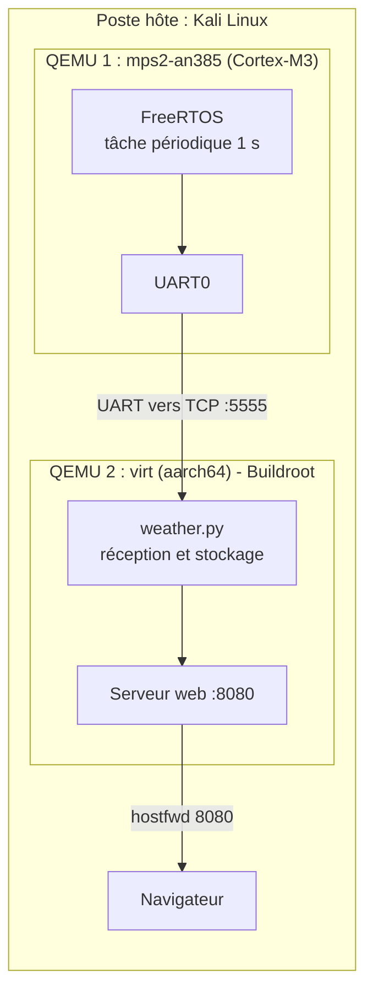
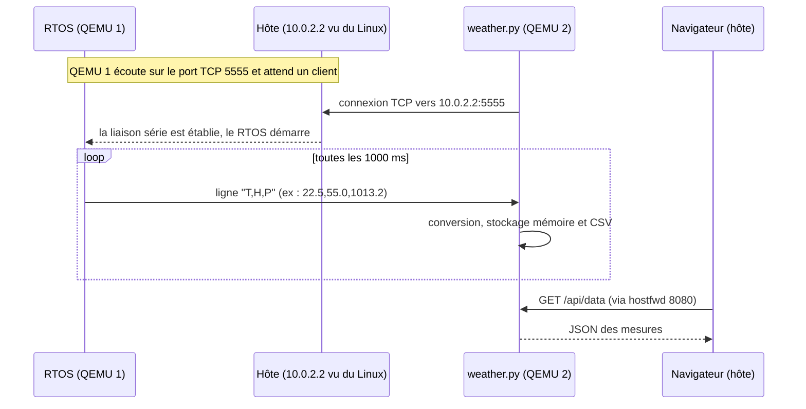

# Architecture détaillée

## Pourquoi deux machines QEMU ?

Un RTOS comme FreeRTOS tourne sur un **microcontrôleur** (ici Cortex-M3), tandis que
Linux tourne sur un **processeur applicatif** (ici Cortex-A53, aarch64). Ce sont deux
architectures différentes, qu'on ne peut pas émuler dans la même machine QEMU. On lance
donc **deux instances** et on les relie, ce qui reproduit le schéma d'un système
industriel hybride : un MCU temps réel + un processeur Linux.

## Vue d'ensemble



## Séquence de fonctionnement



## Réseau de QEMU (mode « user »)

| Adresse | Désigne |
|---|---|
| `10.0.2.15` | Le Linux émulé lui-même (l'invité) |
| `10.0.2.2` | Le poste hôte, vu depuis le Linux émulé |
| `localhost:8080` (hôte) | Redirigé vers le port 8080 du Linux émulé (`hostfwd`) |
| `localhost:5555` (hôte) | Port où le RTOS émet ses mesures (série vers TCP) |

Le Linux émulé peut sortir vers l'hôte, mais rien ne peut entrer sans redirection de
port : c'est le rôle de `hostfwd`.

## Format des données

Une ligne texte par mesure, terminée par `\n`, trois valeurs décimales séparées par
des virgules :

```
température (°C),humidité (%),pression (hPa)
22.5,55.0,1013.2
```

Les lignes mal formées sont ignorées par `weather.py`.

## L'application Linux (`app/weather.py`)

| Élément | Description |
|---|---|
| Thread d'acquisition | Mode simulé (par défaut) ou lecture TCP (`--tcp hote:port`) |
| Stockage | 200 dernières mesures en mémoire, plus un fichier CSV (`/tmp/mesures.csv`) |
| Serveur web | `http.server` de la bibliothèque standard, port 8080 |
| Page `/` | Valeurs actuelles, moyenne/min/max de la température, 15 dernières mesures |
| API `/api/data` | Toutes les mesures en mémoire au format JSON |
| Reconnexion | En cas de perte du RTOS, nouvelle tentative toutes les 2 s |

Aucune dépendance externe : seul Python 3 est nécessaire dans l'image Buildroot.
